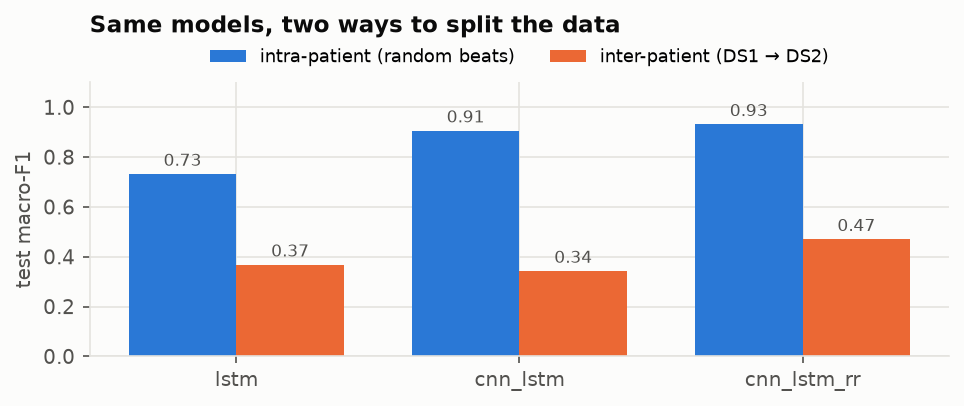
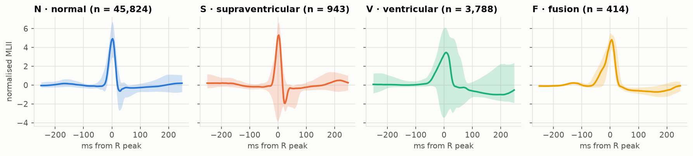
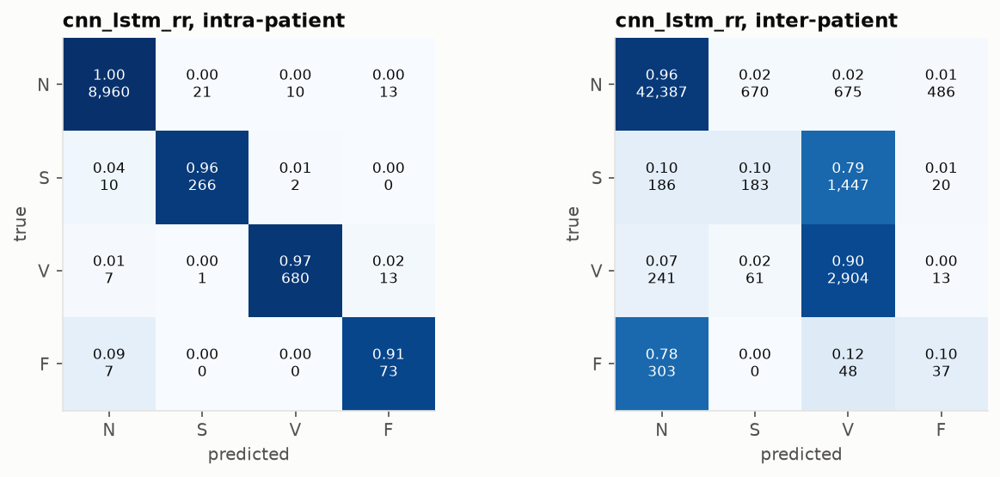

# ECG Arrhythmia Classification on MIT-BIH


Heartbeat classification from a single ECG lead with LSTM and CNN-LSTM networks, into the four
AAMI classes: normal (N), supraventricular ectopic (S), ventricular ectopic (V) and fusion (F).

The first version of this project reported **98.9% accuracy** (normal vs abnormal). It split
heartbeats at random, so beats of every patient were in both the training and the test set, and
the test set also served as the validation set for early stopping. This version evaluates the same
models **inter-patient**: they are trained on one group of patients and tested on another,
following the standard DS1/DS2 split of [de Chazal et al.
(2004)](https://doi.org/10.1109/TBME.2004.827359). The random-beat split is kept as a reference,
so the gap between the two shows how much of the original number came from recognising patients
the model had already seen.

**Result:** the best model, `cnn_lstm_rr`, scores **0.93 macro-F1 when beats are split at random
and 0.47 on patients it has never seen.** Normal and ventricular beats carry over to new patients
(sensitivity 0.96 and 0.90); supraventricular and fusion beats mostly do not (0.10).



## Data

[MIT-BIH Arrhythmia Database](https://physionet.org/content/mitdb/1.0.0/) (PhysioNet, ODC-By 1.0):
48 half-hour two-lead recordings from 47 patients at 360 Hz, with every beat annotated by
cardiologists.

- **Records.** The four records with a pacemaker (102, 104, 107, 217) are excluded, as AAMI
  recommends. The remaining 44 are split into DS1 (22 records, training) and DS2 (22 records,
  test). Records 201, 207 and 223 of DS1 are held out as the validation set.
- **Classes.** Beat annotations are mapped to the AAMI EC57 classes: N = {N, L, R, e, j},
  S = {A, a, J, S}, V = {V, E}, F = {F}. The Q class (paced and unclassifiable beats) is left out.
- **Input.** The MLII lead, band-pass filtered (0.5–40 Hz) and standardised per record. Each
  sample is a 0.5 s window centred on the annotated R peak, plus four RR-interval features:
  previous and next RR relative to the record's mean RR, previous RR relative to the mean of the
  last 10 RRs, and next/previous ratio.

| | N | S | V | F |
| --- | --: | --: | --: | --: |
| DS1 (train + validation) | 45 824 | 943 | 3 788 | 414 |
| DS2 (test) | 44 218 | 1 836 | 3 219 | 388 |



The classes are heavily imbalanced, and S beats look almost like normal ones: what sets them
apart is that they come early. This is why the RR features matter.

## Models

| Model | Input | Architecture |
| --- | --- | --- |
| `lstm` | beat window | 3 stacked LSTM layers (64-128-64), L2 0.01, dropout 0.3 (first version) |
| `cnn_lstm` | beat window | 2 × Conv1D + max-pool, LSTM 200, dropout (first version) |
| `cnn_lstm_rr` | beat window + RR features | `cnn_lstm` features concatenated with an RR branch |

All models use Adam (lr 1e-3), batch 64, cross-entropy weighted by the square root of the
inverse class frequency, at most 30 epochs and early stopping on validation macro-F1 (patience
8). The test set is evaluated once, with the weights of the best validation epoch.

**Metrics** follow the AAMI convention: sensitivity (Se) and positive predictive value (+P) per
class, plus macro-F1 over the four classes. Accuracy is reported but says little here: always
answering N would already score 89% on DS2.

## Results

Test set, one run per model and split (seed 42). Inter-patient: the 22 DS2 records, none of them
seen in training. Random beats: 10% of all beats, drawn from the same patients as the training
set.

| Split | Model | Accuracy | Macro-F1 | N Se | N +P | S Se | S +P | V Se | V +P | F Se | F +P |
| --- | --- | --: | --: | --: | --: | --: | --: | --: | --: | --: | --: |
| random beats | `lstm` | 0.953 | 0.732 | 0.97 | 0.98 | 0.53 | 0.94 | 0.92 | 0.85 | 0.79 | 0.26 |
| random beats | `cnn_lstm` | 0.986 | 0.907 | 0.99 | 1.00 | 0.92 | 0.81 | 0.96 | 0.98 | 0.89 | 0.74 |
| random beats | `cnn_lstm_rr` | 0.992 | **0.932** | 1.00 | 1.00 | 0.96 | 0.92 | 0.97 | 0.98 | 0.91 | 0.74 |
| inter-patient | `lstm` | 0.880 | 0.368 | 0.93 | 0.96 | 0.00 | 0.00 | 0.85 | 0.38 | 0.00 | 0.00 |
| inter-patient | `cnn_lstm` | 0.704 | 0.343 | 0.72 | 0.97 | 0.05 | 0.01 | 0.87 | 0.33 | 0.13 | 0.03 |
| inter-patient | `cnn_lstm_rr` | 0.916 | **0.471** | 0.96 | 0.98 | 0.10 | 0.20 | 0.90 | 0.57 | 0.10 | 0.07 |

The same table, generated from `results/<split>/<model>.json`, is in
[`results/summary.md`](results/summary.md).



- **The random split measures how well the model recognises known patients.** Every model loses
  about half of its macro-F1 or more on new patients. On random beats `cnn_lstm_rr` reaches 99.2%
  accuracy, in line with the 98.9% of the first version, but those test beats come from patients
  the model was trained on.
- **One record decides the inter-patient S score.** Record 232 holds 1381 of the 1836 S beats in
  DS2, and `cnn_lstm_rr` labels 1303 of them as V. Without record 232, S sensitivity is 0.36
  instead of 0.10.
- **F beats do not transfer.** Almost all F beats in DS1 come from one record (208), so the model
  learns one patient's fusion beats and calls 78% of the DS2 F beats normal.
- **RR features help most on new patients.** Adding them to `cnn_lstm` raises macro-F1 from 0.34
  to 0.47 inter-patient, against 0.91 to 0.93 on random beats.
- **The LSTM of the first version is the weakest model.** It scores 0.73 on random beats and finds
  no S or F beats in new patients.
- **Class weights were changed after a first run.** With fully balanced weights (F weighted about
  30 times N), the models labelled a fifth of the normal test beats F, and the same error showed on the
  validation set. Square-root weights and a third validation record raised the inter-patient macro-F1 of
  `cnn_lstm_rr` from 0.38 to 0.47. Because the first test results had been seen by then, the
  inter-patient numbers are slightly optimistic.

## Reproduce

Requires [uv](https://docs.astral.sh/uv/). Training runs on the CPU and takes about two hours
for all six runs on a Ryzen 5 5600X.

```bash
uv sync
./scripts/download_data.sh      # 90 MB from PhysioNet's AWS mirror, SHA-256 checked
./scripts/train_all.sh          # 3 models x 2 splits, resumable, then ecg.report
```

Single run: `uv run python -m ecg.train --model cnn_lstm_rr --split inter`. Pipeline check in
seconds: add `--smoke`. Table and figures only: `uv run python -m ecg.report`.

## Project structure

```text
download_data.sh  ->  ecg.train (3 models x 2 splits)  ->  ecg.report
```

```text
ecg/
  data.py       MIT-BIH loading, filtering, beat windows, RR features, AAMI classes, splits
  models.py     lstm, cnn_lstm, cnn_lstm_rr
  train.py      one model x one split: training, early stopping, test metrics
  report.py     results table and README figures
scripts/        download_data.sh, train_all.sh
results/        <split>/<model>.json per run, summary.md, figures/

Generated locally, not committed:
data/mitdb/     the downloaded database
models/         trained models and the training log
```

## Limitations

- MIT-BIH has 47 patients, and DS2 S beats come mostly from a few records, so per-class numbers
  on S and F depend on a handful of patients.
- Only one lead (MLII) is used, and the beat positions come from the reference annotations
  rather than an R-peak detector.
- Each number comes from a single run with one seed. On the random split the CNN models were
  still improving at epoch 30, so their scores are not the ceiling.

## License

[MIT](LICENSE). The MIT-BIH data is not redistributed here; it is downloaded from PhysioNet
under ODC-By 1.0.
